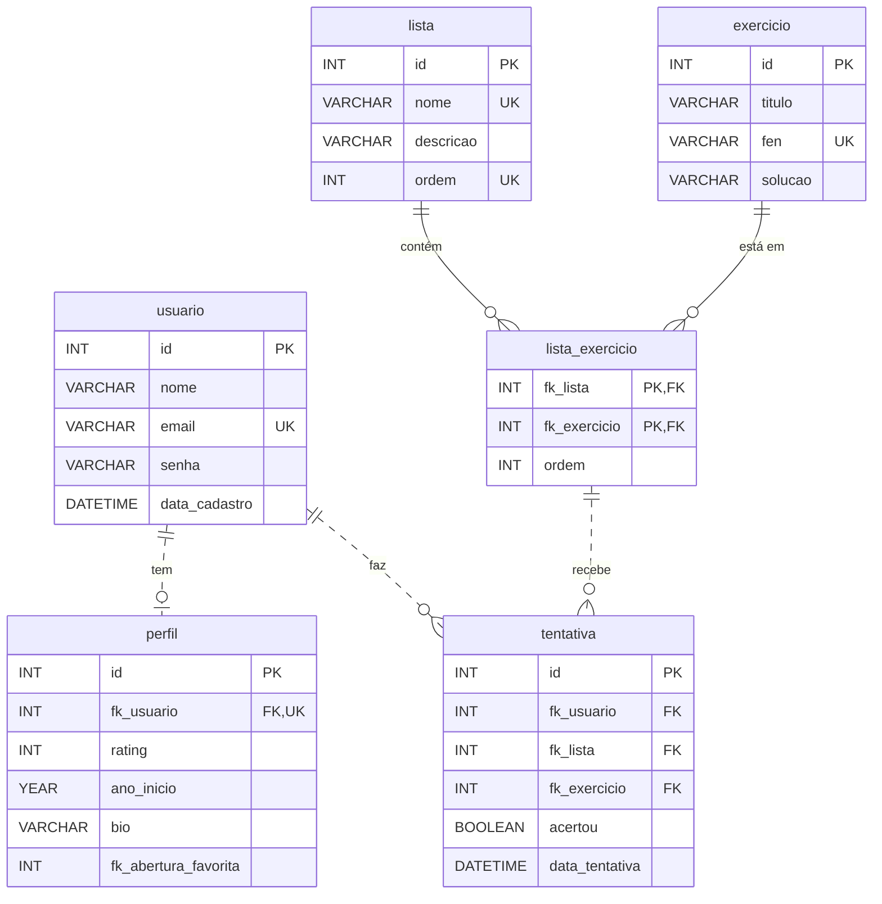

# Chess Life — Database model

The logical data model of Chess Life. The database is modeled and implemented in **MySQL** (version 8.0 or later), hosted on the project's Linux VM (assumptions P02 and R03 in [`01-project.md`](01-project.md)). It changes here first whenever the data model changes.

On 2026-11-09 the model was rebuilt around chess exercises: the games tables (`partida`, `lance`) were replaced by the exercise lists, their exercises and solutions, and the users' attempts. The openings table (`abertura`) and the solution table (`solucao`) were removed the same day: the openings are mocked in the front-end, and each exercise has one solution, stored in its own row. There is no migration: the scripts drop the database and create it again (section 7).

## 1. Scope

The database stores only what the application reads and writes through the API:

- **Users**: sign-up and login (RF01–RF05).
- **Profiles**: chess details of each user (rating, year they started, bio, favorite opening).
- **Openings**: not stored. The known openings are mocked in the front-end, and the profile keeps the id of the one the user chose (section 2).
- **Exercise lists**: the three levels, "Mate em 1", "Mate em 2" and "Mate em 3".
- **Exercises**: a position to solve, in FEN, and its solution, as one line of moves.
- **Attempts**: each try of a user at an exercise, solved or not, feeding the dashboard (RF08–RF10).

Out of the database:

- **Gallery photos**: the image files stay in `public/assets/` and the captions in the gallery's HTML. The page is visual only (P06), so the photos need no table.
- **Sessions**: authentication is the user's session in the browser's `sessionStorage` (see "Authentication" in section 3 of [`02-site-pessoal.md`](02-site-pessoal.md)), so sessions need no table.

## 2. Entities and relationships

| Entity | Table | Kind | Description |
| --- | --- | --- | --- |
| User | `usuario` | Strong | A person with an account, who solves exercises on the site |
| Profile | `perfil` | Strong (own `id`) | Chess details of one user |
| List | `lista` | Strong | A level of exercises, such as "Mate em 2" |
| Exercise | `exercicio` | Strong | A position to solve, with its solution |
| List item | `lista_exercicio` | Associative | An exercise in a list, at a given place |
| Attempt | `tentativa` | Strong | One try of a user at an exercise of a list |

### Relationship kinds

The model follows the MySQL Workbench convention:

- **Identifying relationship (strong)**: the parent's key is part of the child's primary key. The child is a weak entity: it has no identity of its own and cannot exist without the parent.
- **Non-identifying relationship (weak)**: the foreign key is an ordinary column. The child has its own `id`, so its identity does not depend on the parent.

| Relationship | Cardinality | Kind | Foreign key | Why |
| --- | --- | --- | --- | --- |
| `usuario` → `perfil` | 1:1 (one user has zero or one profile) | Non-identifying | `perfil.fk_usuario`, an ordinary column with `UNIQUE` | The profile has its own `id`; the unique FK is what limits each user to one profile |
| `lista` ↔ `exercicio` | N:N (a list has many exercises; an exercise can be in many lists) | Identifying, through `lista_exercicio` | `lista_exercicio.fk_lista` and `fk_exercicio`, together the PK | The pair is the item: it has no meaning without its list and its exercise |
| `usuario` → `tentativa` | 1:N (one user makes zero or many attempts) | Non-identifying | `tentativa.fk_usuario` | An attempt has its own `id` |
| `lista_exercicio` → `tentativa` | 1:N (one list item gets zero or many attempts) | Non-identifying | `tentativa.(fk_lista, fk_exercicio)`, a composite FK | The attempt records which list the exercise was solved in, since an exercise can be in more than one list |

The favorite opening is not a relationship: `perfil.fk_abertura_favorita` holds the id of one of the 49 openings mocked in the front-end, so the column has no foreign key, and the API checks that the id is from 1 to 49. The solution is a column of `exercicio`, since an exercise has exactly one.

In the diagram, a solid line is an identifying relationship and a dashed line is a non-identifying one.



## 3. Data dictionary

### `usuario`

| Column | Type | Null | Key / default | Description |
| --- | --- | --- | --- | --- |
| `id` | `INT` | No | PK, `AUTO_INCREMENT` | User identifier |
| `nome` | `VARCHAR(80)` | No | | Name shown on the site |
| `email` | `VARCHAR(120)` | No | `UNIQUE` | Login e-mail; one account per e-mail (RN01) |
| `senha` | `VARCHAR(100)` | No | | Password in plain text, without hashing, by the author's choice. Up to 100 characters, checked by the API |
| `data_cadastro` | `DATETIME` | No | `CURRENT_TIMESTAMP` | When the account was created |

### `perfil`

| Column | Type | Null | Key / default | Description |
| --- | --- | --- | --- | --- |
| `id` | `INT` | No | PK, `AUTO_INCREMENT` | Profile identifier |
| `rating` | `INT` | Yes | | The user's chess rating, such as 1500 |
| `ano_inicio` | `YEAR` | Yes | | The year the user started playing chess |
| `bio` | `VARCHAR(280)` | Yes | | Short text about the user. The API accepts up to 50 characters |
| `fk_usuario` | `INT` | No | FK → `usuario.id`, `UNIQUE` | The profile's owner. Being unique, it allows at most one profile per user |
| `fk_abertura_favorita` | `INT` | Yes | | The id of the opening the user names as their favorite, from the 49 openings mocked in the front-end. It has no foreign key; the API accepts 1 to 49 |

- The sign-up creates the profile together with the account, in one transaction, so every user has a row in `perfil`. The API requires rating, starting year and bio at sign-up and on update, and the favorite opening is optional. The columns stay nullable as they were; the API is what makes them required.

### `lista`

| Column | Type | Null | Key / default | Description |
| --- | --- | --- | --- | --- |
| `id` | `INT` | No | PK, `AUTO_INCREMENT` | List identifier |
| `nome` | `VARCHAR(40)` | No | `UNIQUE` | Name shown on the site, such as "Mate em 1" |
| `descricao` | `VARCHAR(120)` | No | | One line about the list, shown on its card |
| `ordem` | `INT` | No | `UNIQUE`, `CHECK (ordem >= 1)` | The list's place on the start screen and in the dashboard, from 1 |

### `exercicio`

| Column | Type | Null | Key / default | Description |
| --- | --- | --- | --- | --- |
| `id` | `INT` | No | PK, `AUTO_INCREMENT` | Exercise identifier |
| `titulo` | `VARCHAR(60)` | No | | Name shown on the site, such as "Mate de Légal" |
| `fen` | `VARCHAR(100)` | No | `UNIQUE` | The position in FEN (Forsyth–Edwards Notation), such as `7k/7p/5N2/8/8/8/8/6RK w - - 0 1`. It holds the pieces, the side to move, the castling rights and the en passant square. The same position cannot be two exercises |
| `solucao` | `VARCHAR(100)` | No | | The solution in SAN, the moves separated by spaces, such as `Bxf7+ Ke7 Nd5#`. The user's moves are the 1st, 3rd, 5th… and the opponent's replies the even ones. The last move ends in `#` |

- The side to move is the side the user plays; it is read from the FEN, so it needs no column.
- How many moves the mate takes comes from the solution: a solution of `n` moves is a mate in `(n + 1) / 2`.
- An exercise has exactly one solution, with at least one move. The API splits the column into the array of moves it sends to the page.
- Each solution has one main line: the opponent's replies are fixed, and every user move in it is the only one that keeps the mate in the remaining moves.

### `lista_exercicio`

| Column | Type | Null | Key / default | Description |
| --- | --- | --- | --- | --- |
| `fk_lista` | `INT` | No | PK, FK → `lista.id` | The list |
| `fk_exercicio` | `INT` | No | PK, FK → `exercicio.id` | The exercise |
| `ordem` | `INT` | No | `UNIQUE (fk_lista, ordem)`, `CHECK (ordem >= 1)` | The exercise's place in the list, from 1 |

- An exercise appears at most once in each list (the primary key), and two exercises cannot share a place in the same list (the unique key).

### `tentativa`

| Column | Type | Null | Key / default | Description |
| --- | --- | --- | --- | --- |
| `id` | `INT` | No | PK, `AUTO_INCREMENT` | Attempt identifier |
| `fk_usuario` | `INT` | No | FK → `usuario.id` | Who made the attempt (RN03) |
| `fk_lista` | `INT` | No | FK `(fk_lista, fk_exercicio)` → `lista_exercicio` | The list the exercise was opened from |
| `fk_exercicio` | `INT` | No | FK `(fk_lista, fk_exercicio)` → `lista_exercicio` | The exercise |
| `acertou` | `BOOLEAN` | No | | `TRUE` when the user played the whole solution, `FALSE` when a move was wrong (RN04). The API decides it by comparing the moves with `exercicio.solucao` |
| `data_tentativa` | `DATETIME` | No | `CURRENT_TIMESTAMP` | When the attempt was saved. Set by the database, so it is never in the future (RN05) |

- The composite foreign key makes sure an attempt is always at an exercise that is in that list.
- `BOOLEAN` is `TINYINT(1)` in MySQL, so the database returns `1` or `0`; the API turns them into `true` and `false`.
- The moves the user played are not stored: only whether the attempt was right or wrong.

## 4. Business rules in the database

| Rule | How the model enforces it |
| --- | --- |
| RN01 — unique e-mail | `UNIQUE` on `usuario.email` |
| RN02 — strong password (at least 8 characters with an uppercase letter, a lowercase letter, a digit and a special character) | Checked by the API before saving `senha` |
| RN03 — users only see their own attempts | `tentativa.fk_usuario`; every query filters by it |
| RN04 — an attempt is either right or wrong | `tentativa.acertou` is a `NOT NULL` `BOOLEAN` |
| RN05 — no future attempt date | `tentativa.data_tentativa` defaults to `CURRENT_TIMESTAMP` and the API never sends it |
| An attempt is at an exercise of its list | Composite FK `(fk_lista, fk_exercicio)` → `lista_exercicio` |
| A user has at most one profile | `UNIQUE` on `perfil.fk_usuario` (`uq_perfil_usuario`) |
| An exercise is once in each list, one per place | PK `(fk_lista, fk_exercicio)` and `UNIQUE (fk_lista, ordem)` on `lista_exercicio` |
| An exercise has one solution | `exercicio.solucao`, a single column |
| Places start at 1 | `CHECK` on `lista.ordem` and `lista_exercicio.ordem` |
| The favorite opening is one of the 49 mocked openings | Checked by the API (`perfilController`), since the column has no foreign key |

`CHECK` constraints are enforced from MySQL 8.0.16 onward. Older versions accept and ignore them, so the API validates the values it receives.

Delete behavior of the foreign keys:

- Every foreign key uses MySQL's default `RESTRICT`: a user with a profile or attempts, an exercise in a list, or a list item with attempts cannot be deleted. The site deletes nothing, so no cascade is needed.

## 5. Naming conventions

- Table and column names are in Portuguese, lowercase, in `snake_case`, as in the original specification. Tables are singular (`tentativa`, not `tentativas`). The associative table joins the two names (`lista_exercicio`).
- The primary key of a strong entity is `id`. An associative table's primary key is its two foreign keys. A 1:1 relationship is a unique foreign key (`perfil.fk_usuario`).
- A foreign key is `fk_<table>`, such as `fk_usuario`. When the column has a role of its own, the role follows the table name, such as `fk_abertura_favorita`. That column is the exception to the rule: its id comes from the openings mocked in the front-end, so it has no foreign key.
- Yes-or-no values are `BOOLEAN` (`acertou`).
- Tables use the `utf8mb4` character set, so names with accents ("Légal", "Ópera") are stored correctly. It is MySQL 8's default, so the script does not set it.

## 6. What changed

### From the legacy template

The legacy template's tables were built for the AquaTech sample project. `usuario` was kept and adapted (no `cpf` or `fk_empresa`, plain-text `senha VARCHAR(100)`, `data_cadastro` and a unique `email`); `empresa`, `aviso`, `aquario` and `medida` were removed. The back-end keeps the template's `routes → controllers → models` structure and `src/database/config.js`, rewritten with a connection pool and `?` placeholders.

### From the games model (2026-11-09)

| Before | Now | Reason |
| --- | --- | --- |
| `partida` | Removed; `tentativa` takes its place in the dashboard | The site became an exercise solver: games between two people are no longer played or saved |
| `lance` | Removed; the solution is stored in `exercicio.solucao` | The moves now belong to the exercise, not to what the user played |
| `solucao` (table) | Removed; the solution is the column `exercicio.solucao` | An exercise has exactly one solution, so one column is enough |
| `abertura` | Removed; the 49 openings are mocked in the front-end (`public/shared/profile-form.js`) | Only the profile's favorite opening uses them, and no rule reads them from the database. The profile keeps the id, which the API checks |
| — | `lista`, `exercicio`, `lista_exercicio`, new | The three levels and their exercises, in an N:N relationship |

## 7. Physical model (MySQL scripts)

The physical model is implemented by three scripts in `site-pessoal/src/database/`. Run them in order, as an administrator such as `root`:

| Script | What it does |
| --- | --- |
| `01-schema.sql` | **Drops the `chess_life` database**, then creates it and its six tables, parents first, so every foreign key points to a table that already exists |
| `02-seed.sql` | Loads the three lists, the 15 exercises with their solutions, and their places in the lists |
| `03-app-user.sql` | Drops and creates `chess_life_user`@`localhost`, the MySQL user the API connects with, and grants it only what the API needs |

```
mysql -u <user> -p < site-pessoal/src/database/01-schema.sql
mysql -u <user> -p < site-pessoal/src/database/02-seed.sql
mysql -u <user> -p < site-pessoal/src/database/03-app-user.sql
```

The same files can be opened and run in MySQL Workbench.

- **Running them again starts over**: `01-schema.sql` drops the database with every account and attempt in it, and `03-app-user.sql` drops the user with any privilege it had, such as the ones on the old `partida`, `lance`, `abertura` and `solucao` tables. Back up the data first when it matters.
- **InnoDB and `utf8mb4`** are MySQL 8's defaults, so the script relies on them instead of setting them. Foreign keys need InnoDB.
- **Constraint names**: `uq_<table>_<column>` for unique keys, `fk_<child>_<parent>` for foreign keys and `chk_<table>_<column>` for checks. MySQL ignores names given to primary keys and always calls them `PRIMARY`, so primary keys are not named.
- The seed gives `lista` and `exercicio` explicit ids, so `lista_exercicio` can refer to them in the same script.
- The environment file must point to the database with `DB_DATABASE=chess_life`.

### The exercises

Five exercises per list, written in `02-seed.sql`. Most come from famous games or classic mating patterns; the ones marked "pretas" are played by Black.

| List | Exercises |
| --- | --- |
| Mate em 1 | Mate do Louco (pretas), Mate do Pastor, Mate sufocado na Caro-Kann, Armadilha do Gambito Budapeste (pretas), Mate árabe |
| Mate em 2 | Mate de Légal, Partida da Ópera, Sacrifício de dama na oitava, Sacrifício de dama na primeira (pretas), Mate de Damiano (pretas) |
| Mate em 3 | Réti contra Tartakower, Partida Sempre-Viva, Partida Imortal, Mate de Anastasia (pretas), Mate sufocado |

Every exercise was checked with the full chess rules the site had at the time (castling, en passant, check) and a mate-in-N search: the FEN loads, every solution move is legal, the line ends in checkmate, and each user move is the only one that forces the mate in the moves left. So the page and the API can compare the user's moves with the solution exactly.

### Application user

The API does not connect as `root`. It uses `chess_life_user`, which can only run the statements in [`04-api.md`](04-api.md). A flaw in the API, such as an injected statement, cannot drop tables, change other databases or read MySQL's own users.

| Table | Privileges | Used by |
| --- | --- | --- |
| `usuario` | `SELECT`, `INSERT` | Login, sign-up |
| `perfil` | `SELECT`, `INSERT`, `UPDATE` | Create the profile at sign-up; read and update it on the start screen |
| `lista` | `SELECT` | The lists on the start screen and in the dashboard |
| `exercicio` | `SELECT` | The exercises of a list, the exercise being solved and its solution |
| `lista_exercicio` | `SELECT` | The exercises of a list and their order |
| `tentativa` | `SELECT`, `INSERT` | Save and list the attempts |

- `UPDATE` only on `perfil`, the one table whose rows a route changes (`PUT /perfis/atualizar/:idUsuario`). No `DELETE` anywhere. A new route that needs more gets its `GRANT` added to `03-app-user.sql` in the same change.
- The account is `@'localhost'`, which works while the API and MySQL run on the same machine, as in local development. On the VM, which holds only the database (R09 in [`01-project.md`](01-project.md)), the API connects from another machine, so the account needs that machine's host (for example `'chess_life_user'@'%'` or the host's address) and MySQL must accept remote connections.
- **The password is written in the script**, by the author's choice, so it is public with the repository. It is only for local development: on the VM, give the user another password with `ALTER USER`. The same password goes in the environment file, with `DB_USER=chess_life_user` and `DB_PASSWORD`.

### Example queries

The lists with the user's progress: the derived table holds each exercise the user has solved at least once in each list.

```sql
SELECT l.id, l.nome, l.descricao, COUNT(le.fk_exercicio) AS total_exercicios, COUNT(r.fk_exercicio) AS resolvidos
FROM lista l
    JOIN lista_exercicio le ON le.fk_lista = l.id
    LEFT JOIN (
        SELECT DISTINCT fk_lista, fk_exercicio
        FROM tentativa
        WHERE fk_usuario = ? AND acertou = TRUE
    ) r ON r.fk_lista = le.fk_lista AND r.fk_exercicio = le.fk_exercicio
GROUP BY l.id, l.nome, l.descricao, l.ordem
ORDER BY l.ordem;
```

The user's attempts, for the dashboard:

```sql
SELECT t.id, t.acertou, t.data_tentativa, l.nome AS lista, e.titulo AS exercicio
FROM tentativa t
    JOIN lista l ON l.id = t.fk_lista
    JOIN exercicio e ON e.id = t.fk_exercicio
WHERE t.fk_usuario = ?
ORDER BY t.data_tentativa DESC, t.id DESC;
```

## 8. How the API uses the model

The routes are in [`04-api.md`](04-api.md).

- **Connection**: `src/database/config.js` keeps one connection pool, with `query(sql, values)` for single statements and `transaction(runStatements)` for statements that must succeed or fail together.
- **`usuario` and `perfil`**: sign-up stores the password as plain text and creates the profile in the same transaction (`usuarioModel.createUser`). A duplicate e-mail fails on `uq_usuario_email` (`ER_DUP_ENTRY`) and becomes a `409`. A favorite opening outside 1 to 49 is refused by `perfilController.validateProfile` with a `400` before any query runs. `perfilModel.findProfile` reads the profile's fields, and `updateProfile` replaces every field.
- **Openings**: no table and no model. The list is in `public/shared/profile-form.js`, and the API only checks the id.
- **`lista`**: `listaExerciciosModel.listLists` runs the progress query above.
- **`exercicio` and `lista_exercicio`**: `exercicioModel.listExercises` reads a list's exercises in order, with whether the user has solved each one. `findExercise` reads the exercise, and `findSolution` reads its `solucao` column and splits it into the array of moves.
- **`tentativa`**: `tentativaController.registerAttempt` reads the solution, compares it with the moves sent, and `tentativaModel.registerAttempt` inserts the result. A user, or a list and exercise pair, that does not exist fails on a foreign key (`ER_NO_REFERENCED_ROW_2`) and becomes a `404`. `listAttempts` runs the attempts query above.
