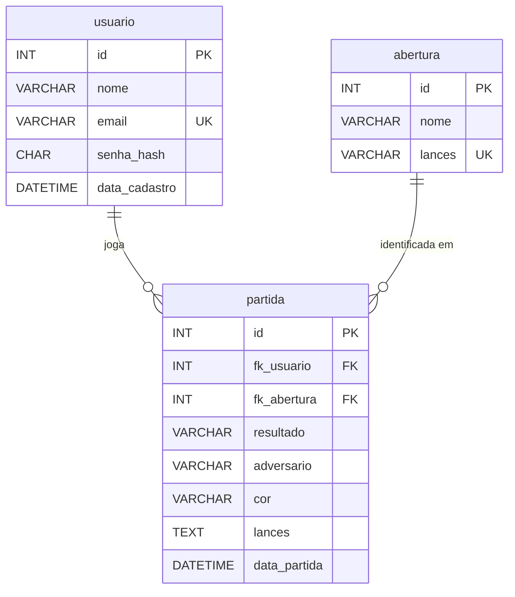

# Chess Life — Database model

The logical data model of Chess Life. The database is modeled and implemented in **MySQL** (version 8.0 or later), hosted on the project's Linux VM (assumptions P02 and R03 in [`01-project.md`](01-project.md)). This is the preliminary model: it guides the adaptation of the legacy tables, and it changes here first whenever the data model changes.

## 1. Scope

The database stores only what the application reads and writes through the API:

- **Users**: sign-up and login (RF01–RF05).
- **Games played on the site**: result, opponent, color, moves and opening, feeding the dashboard (RF08–RF10, RF16).
- **Openings**: the list of known openings the API uses to identify the opening of each game.

Out of the database:

- **Gallery photos**: the image files and captions stay in `public/gallery/` and in the gallery's HTML. The page is visual only (P06), so the photos need no table.
- **Sessions**: the authentication mechanism is still an open decision. JWT needs no table; a server session stored in MySQL would add one, to be modeled here if it is chosen.

## 2. Entities and relationships

| Entity | Table | Description |
| --- | --- | --- |
| User | `usuario` | A person with an account, who plays games on the site |
| Opening | `abertura` | A known chess opening, defined by its first moves |
| Game | `partida` | A game a user finished on the site |

- A **user** plays zero or many **games**; each game belongs to exactly one user (1:N).
- An **opening** is identified in zero or many **games**; each game has exactly one opening (1:N). A game that matches no known opening points to the "Abertura irregular" row.



## 3. Data dictionary

### `usuario`

| Column | Type | Null | Key / default | Description |
| --- | --- | --- | --- | --- |
| `id` | `INT` | No | PK, `AUTO_INCREMENT` | User identifier |
| `nome` | `VARCHAR(80)` | No | | Name shown on the site |
| `email` | `VARCHAR(120)` | No | `UNIQUE` | Login e-mail; one account per e-mail (RN01) |
| `senha_hash` | `CHAR(60)` | No | | bcrypt hash of the password. bcrypt hashes are always 60 characters. The plain password is never stored (RN02 is checked before hashing) |
| `data_cadastro` | `DATETIME` | No | `CURRENT_TIMESTAMP` | When the account was created |

### `abertura`

| Column | Type | Null | Key / default | Description |
| --- | --- | --- | --- | --- |
| `id` | `INT` | No | PK, `AUTO_INCREMENT` | Opening identifier |
| `nome` | `VARCHAR(60)` | No | | Opening name in Portuguese, such as "Defesa Siciliana" |
| `lances` | `VARCHAR(100)` | No | `UNIQUE` | The moves that define the opening, in SAN, separated by spaces, such as `e4 c5`. Empty for "Abertura irregular" |

- `nome` is not unique: one opening can be reached by more than one move order. "Sistema Londres", for example, has three rows (`d4 d5 Bf4`, `d4 Nf6 Bf4`, `d4 d5 Nf3 Nf6 Bf4`). The dashboard groups games by `nome`.
- A game's opening is the row whose `lances` is the longest sequence the game starts with. "Giuoco Piano" (`e4 e5 Nf3 Nc6 Bc4 Bc5`) wins over "Abertura Italiana" (`e4 e5 Nf3 Nc6 Bc4`).

### `partida`

| Column | Type | Null | Key / default | Description |
| --- | --- | --- | --- | --- |
| `id` | `INT` | No | PK, `AUTO_INCREMENT` | Game identifier |
| `fk_usuario` | `INT` | No | FK → `usuario.id` | Who played the game (RN03) |
| `fk_abertura` | `INT` | No | FK → `abertura.id` | Opening identified by the API from `lances` |
| `resultado` | `VARCHAR(7)` | No | `CHECK` | `vitoria`, `derrota` or `empate`, from the user's side (RN04) |
| `adversario` | `VARCHAR(6)` | No | `CHECK` | `humano` or `ia` |
| `cor` | `VARCHAR(7)` | No | `CHECK` | `brancas` or `pretas`, the color the user played |
| `lances` | `TEXT` | No | | Every move of the game in SAN, separated by spaces |
| `data_partida` | `DATETIME` | No | `CURRENT_TIMESTAMP` | When the game was saved. Set by the database, so it is never in the future (RN05) |

- Index `(fk_usuario, data_partida)`: the dashboard lists one user's games ordered by date.

## 4. Business rules in the database

| Rule | How the model enforces it |
| --- | --- |
| RN01 — unique e-mail | `UNIQUE` on `usuario.email` |
| RN02 — password of at least 8 characters | Checked by the API before hashing; the table only stores `senha_hash` |
| RN03 — users only see and delete their own games | `partida.fk_usuario`; every query filters by it |
| RN04 — result is win, loss or draw | `CHECK` on `partida.resultado` |
| RN05 — no future game date | `partida.data_partida` defaults to `CURRENT_TIMESTAMP` and the API never sends it |
| Every game has a user and an opening | `NOT NULL` foreign keys |

`CHECK` constraints are enforced from MySQL 8.0.16 onward. Older versions accept and ignore them, so the API validates the same values.

Foreign keys use MySQL's default `RESTRICT`: a user with games or an opening used by a game cannot be deleted. The site has no account or opening deletion, so no cascade is needed.

## 5. Naming conventions

- Table and column names are in Portuguese, lowercase, in `snake_case`, as in the original specification. Tables are singular (`partida`, not `partidas`).
- The primary key is always `id`. A foreign key is `fk_<table>`, such as `fk_usuario`.
- Fixed value lists (`resultado`, `adversario`, `cor`) are `VARCHAR` with a `CHECK`, without accents, matching the values the API and the front-end already use.
- Tables use the `utf8mb4` character set, so names with accents ("Grünfeld", "Índia") are stored correctly.

## 6. What changes from the legacy model

The legacy template (`site-pessoal/src/database/script-tabelas.sql`) was built for the AquaTech sample project.

| Legacy table | In this model | Reason |
| --- | --- | --- |
| `usuario` | Kept, adapted | Drops `cpf` and `fk_empresa`; `senha` (plain text) becomes `senha_hash`; adds `data_cadastro` and a unique `email` |
| `empresa` | Removed | Chess Life users do not belong to companies |
| `aviso` | Removed | Notices are not part of Chess Life |
| `aquario` | Removed | AquaTech only |
| `medida` | Removed | AquaTech sensor readings only |
| — | `abertura`, new | Openings move from code to the database |
| `partida` (added on 2026-10-15) | Kept, adapted | The opening name in text (`abertura`) becomes a foreign key (`fk_abertura`) |

What the legacy back-end keeps: the `database.executar(sql, parametros)` function in `src/database/config.js` (now with `?` placeholders) and the `routes → controllers → models` structure.

## 7. Physical preview (MySQL DDL)

The script that implements this model. It replaces `script-tabelas.sql` once the adaptation of the legacy back-end is approved.

```sql
CREATE DATABASE chess_life CHARACTER SET utf8mb4 COLLATE utf8mb4_0900_ai_ci;
USE chess_life;

CREATE TABLE usuario (
    id INT PRIMARY KEY AUTO_INCREMENT,
    nome VARCHAR(80) NOT NULL,
    email VARCHAR(120) NOT NULL UNIQUE,
    senha_hash CHAR(60) NOT NULL,
    data_cadastro DATETIME NOT NULL DEFAULT CURRENT_TIMESTAMP
);

CREATE TABLE abertura (
    id INT PRIMARY KEY AUTO_INCREMENT,
    nome VARCHAR(60) NOT NULL,
    lances VARCHAR(100) NOT NULL UNIQUE
);

CREATE TABLE partida (
    id INT PRIMARY KEY AUTO_INCREMENT,
    fk_usuario INT NOT NULL,
    fk_abertura INT NOT NULL,
    resultado VARCHAR(7) NOT NULL,
    adversario VARCHAR(6) NOT NULL,
    cor VARCHAR(7) NOT NULL,
    lances TEXT NOT NULL,
    data_partida DATETIME NOT NULL DEFAULT CURRENT_TIMESTAMP,
    CHECK (resultado IN ('vitoria', 'derrota', 'empate')),
    CHECK (adversario IN ('humano', 'ia')),
    CHECK (cor IN ('brancas', 'pretas')),
    FOREIGN KEY (fk_usuario) REFERENCES usuario(id),
    FOREIGN KEY (fk_abertura) REFERENCES abertura(id),
    INDEX idx_partida_usuario_data (fk_usuario, data_partida)
);

-- Seed: one row per entry of OPENINGS in src/models/openingBook.js, plus the fallback.
INSERT INTO abertura (nome, lances) VALUES
    ('Abertura irregular', ''),
    ('Abertura do Peão do Rei', 'e4'),
    ('Defesa Siciliana', 'e4 c5'),
    ('Siciliana: Dragão Acelerado', 'e4 c5 Nf3 Nc6 d4 cxd4 Nxd4 g6');
    -- ...the other openings of the list
```

Example query, the dashboard's game list:

```sql
SELECT p.id, p.resultado, p.adversario, p.cor, a.nome AS abertura, p.data_partida
FROM partida p
    JOIN abertura a ON a.id = p.fk_abertura
WHERE p.fk_usuario = ?
ORDER BY p.data_partida DESC;
```

## 8. Impact on the current code

Not built yet. Each change to `src/` needs the user's approval first.

- `script-tabelas.sql` is replaced by the script in section 7, with the full opening seed.
- `openingBook.js` reads the openings from the `abertura` table instead of its `OPENINGS` constant, keeping the longest-match rule, and returns the opening's `id`.
- `partidaModel.registerGame` saves `fk_abertura`. `listGames` joins `abertura` and keeps returning the name as `abertura`, so the API contract and the dashboard do not change.
- `usuarioModel` and `usuarioController` follow the new `usuario` table (see section 6, "Planned adaptation", in [`02-site-pessoal.md`](02-site-pessoal.md)).
