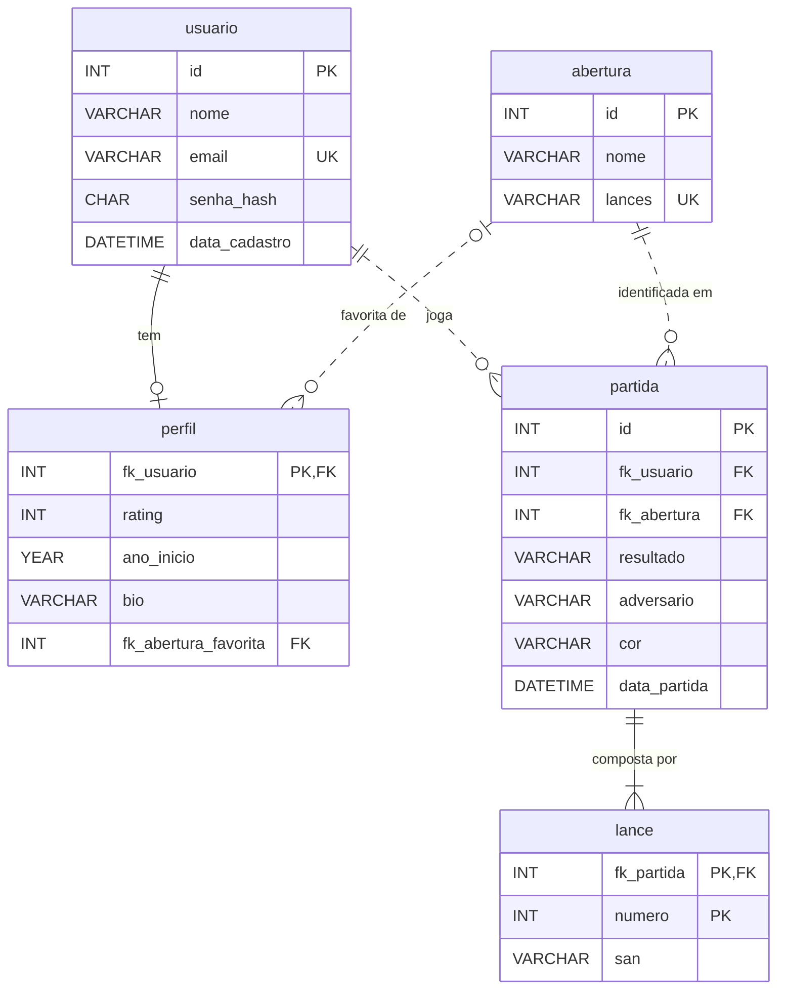

# Chess Life — Database model

The logical data model of Chess Life. The database is modeled and implemented in **MySQL** (version 8.0 or later), hosted on the project's Linux VM (assumptions P02 and R03 in [`01-project.md`](01-project.md)). This is the preliminary model: it guides the adaptation of the legacy tables, and it changes here first whenever the data model changes.

## 1. Scope

The database stores only what the application reads and writes through the API:

- **Users**: sign-up and login (RF01–RF05).
- **Profiles**: optional chess details of each user (rating, year they started, bio, favorite opening).
- **Games played on the site**: result, opponent, color and opening, feeding the dashboard (RF08–RF10, RF16).
- **Moves**: every move of each game, in order.
- **Openings**: the list of known openings the API uses to identify the opening of each game.

Out of the database:

- **Gallery photos**: the image files and captions stay in `public/gallery/` and in the gallery's HTML. The page is visual only (P06), so the photos need no table.
- **Sessions**: the authentication mechanism is still an open decision. JWT needs no table; a server session stored in MySQL would add one, to be modeled here if it is chosen.

## 2. Entities and relationships

| Entity | Table | Kind | Description |
| --- | --- | --- | --- |
| User | `usuario` | Strong | A person with an account, who plays games on the site |
| Profile | `perfil` | Weak (depends on `usuario`) | Optional chess details of one user |
| Opening | `abertura` | Strong | A known chess opening, defined by its first moves |
| Game | `partida` | Strong | A game a user finished on the site |
| Move | `lance` | Weak (depends on `partida`) | One move of a game, at a given position |

### Relationship kinds

The model follows the MySQL Workbench convention:

- **Identifying relationship (strong)**: the parent's key is part of the child's primary key. The child is a weak entity: it has no identity of its own and cannot exist without the parent.
- **Non-identifying relationship (weak)**: the foreign key is an ordinary column. The child has its own `id`, so its identity does not depend on the parent.

| Relationship | Cardinality | Kind | Foreign key | Why |
| --- | --- | --- | --- | --- |
| `usuario` → `perfil` | 1:1 (one user has zero or one profile) | Identifying | `perfil.fk_usuario`, which is also the PK | Using the FK as the PK is what limits each user to one profile |
| `partida` → `lance` | 1:N (one game has one or many moves) | Identifying | `lance.fk_partida`, part of the PK `(fk_partida, numero)` | A move is only "move 12 of game 40": it has no meaning without its game |
| `usuario` → `partida` | 1:N (one user plays zero or many games) | Non-identifying | `partida.fk_usuario` | A game has its own `id`, used by the API to delete it |
| `abertura` → `partida` | 1:N (one opening appears in zero or many games) | Non-identifying | `partida.fk_abertura` | Each game has exactly one opening. A game that matches no known opening points to the "Abertura irregular" row |
| `abertura` → `perfil` | 1:N (one opening is the favorite of zero or many profiles) | Non-identifying, optional | `perfil.fk_abertura_favorita` | The favorite opening is optional, so the column accepts `NULL` |

In the diagram, a solid line is an identifying relationship and a dashed line is a non-identifying one.



## 3. Data dictionary

### `usuario`

| Column | Type | Null | Key / default | Description |
| --- | --- | --- | --- | --- |
| `id` | `INT` | No | PK, `AUTO_INCREMENT` | User identifier |
| `nome` | `VARCHAR(80)` | No | | Name shown on the site |
| `email` | `VARCHAR(120)` | No | `UNIQUE` | Login e-mail; one account per e-mail (RN01) |
| `senha_hash` | `CHAR(60)` | No | | bcrypt hash of the password. bcrypt hashes are always 60 characters. The plain password is never stored (RN02 is checked before hashing) |
| `data_cadastro` | `DATETIME` | No | `CURRENT_TIMESTAMP` | When the account was created |

### `perfil`

| Column | Type | Null | Key / default | Description |
| --- | --- | --- | --- | --- |
| `fk_usuario` | `INT` | No | PK, FK → `usuario.id` | The profile's owner. As the PK, it allows at most one profile per user |
| `rating` | `INT` | Yes | | The user's chess rating, such as 1500 |
| `ano_inicio` | `YEAR` | Yes | | The year the user started playing chess |
| `bio` | `VARCHAR(280)` | Yes | | Short text about the user |
| `fk_abertura_favorita` | `INT` | Yes | FK → `abertura.id` | The opening the user names as their favorite |

- The profile is optional: a user may have no row in `perfil`.
- `fk_abertura_favorita` is what the user chooses. It is not the dashboard's "abertura favorita" indicator, which is computed from the games played.

### `abertura`

| Column | Type | Null | Key / default | Description |
| --- | --- | --- | --- | --- |
| `id` | `INT` | No | PK, `AUTO_INCREMENT` | Opening identifier |
| `nome` | `VARCHAR(60)` | No | | Opening name in Portuguese, such as "Defesa Siciliana" |
| `lances` | `VARCHAR(100)` | No | `UNIQUE` | The moves that define the opening, in SAN, separated by spaces, such as `e4 c5`. Empty for "Abertura irregular" |

- `nome` is not unique: one opening can be reached by more than one move order. "Sistema Londres", for example, has three rows (`d4 d5 Bf4`, `d4 Nf6 Bf4`, `d4 d5 Nf3 Nf6 Bf4`). The dashboard groups games by `nome`.
- A game's opening is the row whose `lances` is the longest sequence the game starts with. "Giuoco Piano" (`e4 e5 Nf3 Nc6 Bc4 Bc5`) wins over "Abertura Italiana" (`e4 e5 Nf3 Nc6 Bc4`).
- `lances` stays as text here, unlike a game's moves. It is a single value, the definition of the opening, compared by prefix, and not a list of separate facts.

### `partida`

| Column | Type | Null | Key / default | Description |
| --- | --- | --- | --- | --- |
| `id` | `INT` | No | PK, `AUTO_INCREMENT` | Game identifier |
| `fk_usuario` | `INT` | No | FK → `usuario.id` | Who played the game (RN03) |
| `fk_abertura` | `INT` | No | FK → `abertura.id` | Opening identified by the API from the game's moves |
| `resultado` | `VARCHAR(7)` | No | `CHECK` | `vitoria`, `derrota` or `empate`, from the user's side (RN04) |
| `adversario` | `VARCHAR(6)` | No | `CHECK` | `humano` or `ia` |
| `cor` | `VARCHAR(7)` | No | `CHECK` | `brancas` or `pretas`, the color the user played |
| `data_partida` | `DATETIME` | No | `CURRENT_TIMESTAMP` | When the game was saved. Set by the database, so it is never in the future (RN05) |

- Index `(fk_usuario, data_partida)`: the dashboard lists one user's games ordered by date.
- The moves are in `lance`, not in a column of `partida`, so each move is stored once (first normal form).

### `lance`

| Column | Type | Null | Key / default | Description |
| --- | --- | --- | --- | --- |
| `fk_partida` | `INT` | No | PK, FK → `partida.id`, `ON DELETE CASCADE` | The game the move belongs to |
| `numero` | `INT` | No | PK, `CHECK` | The move's position in the game, starting at 1. Each move of each side counts (a half-move): 1 is white's first move, 2 is black's reply |
| `san` | `VARCHAR(10)` | No | | The move in standard algebraic notation (SAN), such as `Nf3`, `exd5` or `O-O` |

- A game has at least one move. The database cannot require a child row, so the API rejects a game with no moves.
- `san` fits in 10 characters: the longest SAN moves, such as `Qh4xe1+` or `exd8=Q#`, have 7.

## 4. Business rules in the database

| Rule | How the model enforces it |
| --- | --- |
| RN01 — unique e-mail | `UNIQUE` on `usuario.email` |
| RN02 — password of at least 8 characters | Checked by the API before hashing; the table only stores `senha_hash` |
| RN03 — users only see and delete their own games | `partida.fk_usuario`; every query filters by it. Deleting a game deletes its moves (`ON DELETE CASCADE` on `lance`) |
| RN04 — result is win, loss or draw | `CHECK` on `partida.resultado` |
| RN05 — no future game date | `partida.data_partida` defaults to `CURRENT_TIMESTAMP` and the API never sends it |
| Every game has a user and an opening | `NOT NULL` foreign keys |
| A user has at most one profile | `perfil.fk_usuario` is the primary key |
| A position holds one move per game | Primary key `(fk_partida, numero)` on `lance` |
| Move positions start at 1 | `CHECK (numero >= 1)` on `lance` |

`CHECK` constraints are enforced from MySQL 8.0.16 onward. Older versions accept and ignore them, so the API validates the same values.

Delete behavior of the foreign keys:

- `lance.fk_partida` uses `ON DELETE CASCADE`: users delete games (RN03), and a move cannot exist without its game.
- Every other foreign key uses MySQL's default `RESTRICT`: a user with a profile or games, or an opening used by a game or a profile, cannot be deleted. The site has no account or opening deletion, so no other cascade is needed.

## 5. Naming conventions

- Table and column names are in Portuguese, lowercase, in `snake_case`, as in the original specification. Tables are singular (`partida`, not `partidas`).
- The primary key of a strong entity is `id`. A weak entity's primary key is made of its parent's foreign key, plus a column that tells its rows apart when the parent has many (`lance`: `fk_partida, numero`). In a 1:1 relationship, the foreign key alone is the primary key (`perfil.fk_usuario`).
- A foreign key is `fk_<table>`, such as `fk_usuario`. When the column has a role of its own, the role follows the table name, such as `fk_abertura_favorita`.
- Fixed value lists (`resultado`, `adversario`, `cor`) are `VARCHAR` with a `CHECK`, without accents, matching the values the API and the front-end already use.
- Tables use the `utf8mb4` character set, so names with accents ("Grünfeld", "Índia") are stored correctly.

## 6. What changes from the legacy model

The legacy template (`site-pessoal/src/database/script-tabelas.sql`) was built for the AquaTech sample project.

| Legacy table | In this model | Reason |
| --- | --- | --- |
| `usuario` | Kept, adapted | Drops `cpf` and `fk_empresa`; `senha` (plain text) becomes `senha_hash`; adds `data_cadastro` and a unique `email` |
| `empresa` | Removed | Chess Life users do not belong to companies |
| `aviso` | Removed | Notices are not part of Chess Life |
| `aquario` | Removed | AquaTech only |
| `medida` | Removed | AquaTech sensor readings only |
| — | `perfil`, new | Optional chess details of each user (1:1 with `usuario`) |
| — | `abertura`, new | Openings move from code to the database |
| `partida` (added on 2026-10-15) | Kept, adapted | The opening name in text (`abertura`) becomes a foreign key (`fk_abertura`), and the moves in text (`lances`) move to the `lance` table |
| — | `lance`, new | One row per move, replacing `partida.lances` |

What the legacy back-end keeps: the `database.executar(sql, parametros)` function in `src/database/config.js` (now with `?` placeholders) and the `routes → controllers → models` structure.

## 7. Physical preview (MySQL DDL)

The script that implements this model. It replaces `script-tabelas.sql` once the adaptation of the legacy back-end is approved. Tables are created parents first, so every foreign key points to a table that already exists.

```sql
CREATE DATABASE chess_life CHARACTER SET utf8mb4 COLLATE utf8mb4_0900_ai_ci;
USE chess_life;

CREATE TABLE usuario (
    id INT PRIMARY KEY AUTO_INCREMENT,
    nome VARCHAR(80) NOT NULL,
    email VARCHAR(120) NOT NULL UNIQUE,
    senha_hash CHAR(60) NOT NULL,
    data_cadastro DATETIME NOT NULL DEFAULT CURRENT_TIMESTAMP
);

CREATE TABLE abertura (
    id INT PRIMARY KEY AUTO_INCREMENT,
    nome VARCHAR(60) NOT NULL,
    lances VARCHAR(100) NOT NULL UNIQUE
);

CREATE TABLE perfil (
    fk_usuario INT PRIMARY KEY,
    rating INT,
    ano_inicio YEAR,
    bio VARCHAR(280),
    fk_abertura_favorita INT,
    FOREIGN KEY (fk_usuario) REFERENCES usuario(id),
    FOREIGN KEY (fk_abertura_favorita) REFERENCES abertura(id)
);

CREATE TABLE partida (
    id INT PRIMARY KEY AUTO_INCREMENT,
    fk_usuario INT NOT NULL,
    fk_abertura INT NOT NULL,
    resultado VARCHAR(7) NOT NULL,
    adversario VARCHAR(6) NOT NULL,
    cor VARCHAR(7) NOT NULL,
    data_partida DATETIME NOT NULL DEFAULT CURRENT_TIMESTAMP,
    CHECK (resultado IN ('vitoria', 'derrota', 'empate')),
    CHECK (adversario IN ('humano', 'ia')),
    CHECK (cor IN ('brancas', 'pretas')),
    FOREIGN KEY (fk_usuario) REFERENCES usuario(id),
    FOREIGN KEY (fk_abertura) REFERENCES abertura(id),
    INDEX idx_partida_usuario_data (fk_usuario, data_partida)
);

CREATE TABLE lance (
    fk_partida INT,
    numero INT,
    san VARCHAR(10) NOT NULL,
    PRIMARY KEY (fk_partida, numero),
    CHECK (numero >= 1),
    FOREIGN KEY (fk_partida) REFERENCES partida(id) ON DELETE CASCADE
);

-- Seed: one row per entry of OPENINGS in src/models/openingBook.js, plus the fallback.
INSERT INTO abertura (nome, lances) VALUES
    ('Abertura irregular', ''),
    ('Abertura do Peão do Rei', 'e4'),
    ('Defesa Siciliana', 'e4 c5'),
    ('Siciliana: Dragão Acelerado', 'e4 c5 Nf3 Nc6 d4 cxd4 Nxd4 g6');
    -- ...the other openings of the list
```

Example query, the dashboard's game list:

```sql
SELECT p.id, p.resultado, p.adversario, p.cor, a.nome AS abertura, p.data_partida
FROM partida p
    JOIN abertura a ON a.id = p.fk_abertura
WHERE p.fk_usuario = ?
ORDER BY p.data_partida DESC;
```

Example query, the moves of one of the user's games in order. The join with `partida` keeps a user from reading another user's game (RN03):

```sql
SELECT l.numero, l.san
FROM lance l
    JOIN partida p ON p.id = l.fk_partida
WHERE l.fk_partida = ? AND p.fk_usuario = ?
ORDER BY l.numero;
```

The rows are joined into text in JavaScript, not with `GROUP_CONCAT`, because MySQL cuts `GROUP_CONCAT` results at 1024 bytes by default (`group_concat_max_len`), which a long game exceeds.

## 8. Impact on the current code

Not built yet. Each change to `src/` needs the user's approval first.

- `script-tabelas.sql` is replaced by the script in section 7, with the full opening seed.
- `openingBook.js` reads the openings from the `abertura` table instead of its `OPENINGS` constant, keeping the longest-match rule, and returns the opening's `id`. Moving the moves to `lance` does not affect it: it identifies the opening from the move list in the request, before anything is saved.
- `partidaModel.registerGame` inserts the game and then all its moves in one multi-row `INSERT` into `lance`, numbered from 1 in the order received. Both inserts run in one transaction, so a failure never leaves a game without moves. `database.executar` opens one connection per query and cannot hold a transaction, so `config.js` needs a function that runs several statements on one connection between `BEGIN` and `COMMIT`.
- `listGames` joins `abertura` and keeps returning the name as `abertura`, so the API contract and the dashboard do not change. It does not read `lance`.
- `perfil` has no API or page yet: no requirement in [`01-project.md`](01-project.md) uses it so far.
- `usuarioModel` and `usuarioController` follow the new `usuario` table (see section 6, "Planned adaptation", in [`02-site-pessoal.md`](02-site-pessoal.md)).
