<div align="center">


# Chess Life

### Toda partida começa igual. *O que muda é quem joga.*

**Site pessoal sobre como o xadrez impactou a minha vida.**


</div>

<div align="center">
  
</div>

## ♟️ Sobre o projeto

O Chess Life é o projeto individual da disciplina de Pesquisa e Inovação do curso de Análise e Desenvolvimento de Sistemas da SPTech. O site conta a minha história com o xadrez e tem uma área restrita em que cada usuário resolve exercícios de mate e acompanha o seu desempenho. O banco de dados MySQL será hospedado em uma VM Linux que contém somente o banco.

O site tem **5 páginas**:

| | Página | Acesso | Descrição |
|:---:|---|:---:|---|
| ♚ | **Minha história** | Público | Linha do tempo, competências socioemocionais, agradecimentos e inspirações. |
| ♝ | **Galeria** | Público | Fotos de torneios, medalhas e estudo, em grade no estilo do Instagram. |
| ♟ | **Cadastro e Login** | Público | Conta com nome, e-mail e senha, e o perfil de jogador. |
| ♞ | **Exercícios** | Restrito | Três listas (mate em 1, 2 e 3) resolvidas no tabuleiro; cada tentativa é salva. |
| ♜ | **Dashboard** | Restrito | Indicadores e gráficos em Chart.js das tentativas, por período. |

## ⚙️ Como rodar

Requer Node.js e MySQL 8.0 ou mais recente.

1. Crie o banco rodando, em ordem, os scripts de `web-data-viz/src/database/`: `01-schema.sql`, `02-seed.sql` e `03-app-user.sql`.
2. Em `web-data-viz/`, crie o `.env.dev` a partir do `.env.dev.example`, com `DB_DATABASE=chess_life`, `DB_USER=chess_life_user` e a senha desse usuário em `DB_PASSWORD`.
3. Suba o servidor e abra `http://localhost:3333`:

   ```bash
   cd web-data-viz
   npm install
   npm start
   ```

## 🔗 Links

| Documento | Link |
|---|---|
| Backlog | [Excel](https://bandteccom-my.sharepoint.com/:x:/g/personal/igor_pereira_sptech_school/cQoB32ROiFJiSq6LbogKJvl1EgUBBY31kn9WjtR-2xRbY0_Dww) |
| Documentação | [Word](https://bandteccom-my.sharepoint.com/:w:/g/personal/igor_pereira_sptech_school/cQooCKEs-ip5SapBH_Jk1bDXEgUBJ2IY-cSlXTG-Yeqs-WTp9w) |
| Gerenciador de Tarefas | [Trello](https://trello.com/b/uLpMNg6H/chess-life) |
| Documentação Técnica | [.docs](.docs/README.md) |

## 👤 Autor

| Nome | E-mail |
|---|---|
| Igor Pereira | igor.pereira@sptech.school |

<div align="center">

<br />

*A partida continua. Sua vez.*


</div>
