<div align="center">



</div>


## O que é isto

**Chess Life** é um site pessoal sobre como o xadrez mudou a minha vida. É o projeto individual da disciplina de Pesquisa e Inovação, do curso de Análise e Desenvolvimento de Sistemas da SPTech.

O site tem duas partes. A pública conta a história: uma linha do tempo de como tudo começou e uma galeria de fotos no estilo do Instagram. A restrita é um dashboard: quem cria uma conta joga no site, cada partida vai para o banco de dados e vira gráfico.

> No xadrez, toda posição carrega os lances que levaram até ela. Este site é a minha posição atual.

## A história em lances

A página *Minha história* conta a trajetória como uma partida, lance por lance.

| Lance | Momento | O que aconteceu |
| --- | --- | --- |
| **1.** | 4ª série | Uma seleção para alunos interessados em xadrez abriu a porta para o jogo. |
| **2.** | No mesmo ano | Venci as seis partidas que disputei e ajudei a minha escola a ganhar a medalha de ouro. |
| **3.** | Anos seguintes | O tabuleiro despertou o meu interesse por geometria e ângulos, o que contribuiu para uma medalha de bronze na OBMEP. |
| **4.** | Estudo | Aprofundei as aberturas: a Defesa Siciliana, em especial o Dragão Acelerado, e a Abertura Italiana. |
| **5.** | Hoje | Cerca de 1500 de rating em partidas de 10 minutos e 1400 em partidas sem acréscimo. |

Inspirações pelo caminho: os GMs Krikor Mekhitarian e Evandro Barbosa, no Brasil, e Hikaru Nakamura, Magnus Carlsen e Andrea Botez, no mundo.


## O que tem no site

| Página | O que mostra | Acesso |
| --- | --- | --- |
| **Início** | apresentação do projeto e caminho para todas as seções | público |
| **Minha história** | a linha do tempo da tabela acima | público |
| **Galeria** | fotos de torneios, medalhas e horas de estudo, em grade | público |
| **Cadastro e Login** | conta com nome, e-mail e senha | público |
| **Meu desempenho no xadrez** | indicadores, gráficos e a lista de partidas jogadas no site | restrito |
| **Jogar** *(complementar)* | tabuleiro para jogar contra uma IA | restrito |

## O dashboard

As partidas não são digitadas à mão: só chegam ao dashboard as que foram jogadas no site. Quando uma partida termina, a API recebe os lances, identifica a abertura e grava tudo no MySQL.



A identificação compara os lances da partida com cerca de 50 aberturas conhecidas e escolhe a linha mais longa que bate. Por isso `e4 c5` é só "Defesa Siciliana", mas `e4 c5 Nf3 Nc6 d4 cxd4 Nxd4 g6` já é "Siciliana: Dragão Acelerado".

Com essas partidas, o dashboard mostra:

- **Partidas hoje**, comparadas com ontem.
- **Taxa de vitória total**, comparada com a de até ontem, em pontos percentuais.
- **Abertura favorita**, com quantas partidas e a taxa de vitória nela.
- **Partidas por semana** nas últimas 8 semanas, separadas em vitórias, derrotas e empates.
- **Resultados** e **aberturas mais jogadas** em gráficos do Chart.js.
- **Tabela de partidas**, com a opção de apagar cada uma.


## A estética

A direção é a de um clube de xadrez clássico: papel creme, verde de mesa de torneio, latão de troféu e as duas cores do tabuleiro. Os títulos usam Georgia e o texto usa a fonte do sistema, sem fontes externas.



| Cor | Código | Papel no projeto |
| --- | --- | --- |
| Papel | `#f4efe6` | o fundo, como uma folha de anotação de partida |
| Verde | `#2f4a3a` | cabeçalhos, botões e o selo do logo |
| Latão | `#b08d57` | destaques, como o "Life" do nome |
| Tinta | `#1f1a14` | o texto |
| Casa clara | `#e9dcc3` | as casas claras do tabuleiro |
| Casa escura | `#a88a63` | as casas escuras do tabuleiro |

O logo é um rei creme dentro de um selo verde com aro de latão, e também é o ícone da aba do navegador.

## Tecnologias

<p align="center">
  
</p>

| Tecnologia | Papel |
| --- | --- |
| **HTML, CSS e JavaScript** | as páginas, o visual e a interação, sem framework |
| **Node.js e Express** | a API REST, que também serve as páginas |
| **MySQL** | usuários e partidas, numa máquina virtual Linux |
| **Chart.js** | os gráficos do dashboard |
| **bcrypt** | as senhas, guardadas só como hash |
| **chess.js e Stockfish ou Gemini** | regras e jogadas da IA, no módulo complementar |

O back-end nasceu do template **web-data-viz** da SPTech e está sendo adaptado para o Chess Life.

## O caminho



O plano anda como um peão: uma casa por etapa, até a promoção na última. O jogo contra a IA é complementar e só começa depois que o resto estiver pronto.

| Etapa | Situação |
| --- | --- |
| Documentação, requisitos e protótipos | pronta |
| Páginas públicas: início, história e galeria | prontas, a galeria ainda com espaços para as fotos |
| API de partidas e dashboard | prontos, aguardando a página de jogo para receber partidas |
| Cadastro e login | telas prontas, API em adaptação (bcrypt e controle de acesso) |
| Página de jogo, VM, deploy e IA | a fazer |

## Como rodar

Você precisa do Node.js e de um MySQL 8.0 ou mais recente.

1. Crie o banco e as tabelas rodando o script `site-pessoal/src/database/script-tabelas.sql` no MySQL. Por enquanto, o banco ainda tem o nome herdado do template, `aquatech`.
2. Dentro de `site-pessoal/`, crie o arquivo `.env.dev` com as variáveis abaixo. Ele tem credenciais, então não vai para o git.

   ```env
   AMBIENTE_PROCESSO=desenvolvimento
   DB_HOST=localhost
   DB_DATABASE=aquatech
   DB_USER=seu_usuario
   DB_PASSWORD=sua_senha
   DB_PORT=3306
   APP_PORT=3333
   APP_HOST=localhost
   ```

3. Instale as dependências e suba o servidor:

   ```bash
   cd site-pessoal
   npm install
   npm start        # ou npm run dev, que reinicia a cada alteração
   ```

4. Abra `http://localhost:3333`.

## Documentação

Os detalhes ficam em `.docs/`:

- [`01-project.md`](.docs/01-project.md): requisitos, regras de negócio, arquitetura e plano.
- [`03-database.md`](.docs/03-database.md): modelo de dados e DDL do MySQL.
- [`02-site-pessoal.md`](.docs/02-site-pessoal.md): estrutura da aplicação, convenções e API.
- [`decisions.md`](.docs/decisions.md): as decisões do projeto e o porquê de cada uma.


<div align="center">


feito lance a lance por **Igor Fuchs Pereira** · [@igor-fuchs01](https://github.com/igor-fuchs01) · licença [MIT](LICENSE)

</div>
